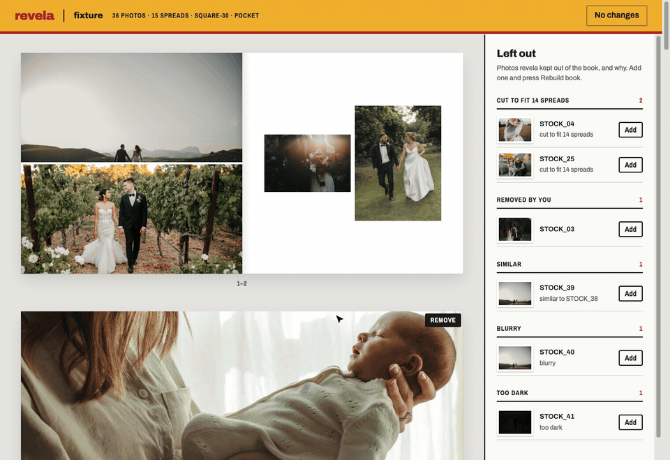

# revela

Turns an iCloud album into a layflat photobook without any photo leaving your computer.
[icloudpd](https://github.com/icloud-photos-downloader/icloud_photos_downloader) downloads the album.
MediaPipe and CLIP score the photos on this machine, and revela picks and lays them out.

## Use

Ask your agent for a book from an album. Or run it yourself:

```bash
cp .env.example .env                       # your iCloud user
./revela login                             # Apple login and 2FA; again when Apple asks
./revela make "Beach 2026"                 # download, score, pick and lay out; prints the review link
./revela release "Beach 2026"              # one JPEG per spread and book.pdf, 300 DPI, 3 mm bleed
```

`make` takes `--format` (`square-20`, `square-25`, `square-30`, `landscape-a4`, `portrait-20x25`, or `WIDTHxHEIGHT` in mm),
`--style` (`pocket`: full bleed, at most 2 photos a page; `scrapbook`: cream paper, wide margins) and `--spreads`.

On the review page, remove a photo, add one that revela left out, and rebuild the book:



A heart on a photo in the iPhone Photos app keeps that photo in the book.

## Privacy

- The `sync` service is the only one with network, and it only talks to Apple. The models come in at build time, and `revela` runs without network.
- The `review` page listens on `127.0.0.1` only, accepts only a local `Host`, refuses a change sent by another site, and loads nothing from outside.
- `data/session` gives access to all your iCloud photos. Do not copy it off this machine.
- An agent with a cloud LLM sends every photo or PDF that it opens to the provider. `AGENTS.md` tells it not to open them,
  and each agent has a lock on `data/` with a gap:
  - Claude Code: `.claude/settings.json` blocks the Read tool, but not shell commands such as `cat`.
  - Cursor: `.cursorignore` blocks the agent's file tools, but not its terminal.
  - Codex: `.codex/config.toml` blocks sandboxed commands, but only in a trusted project and without a `sandbox_mode` in any config.
